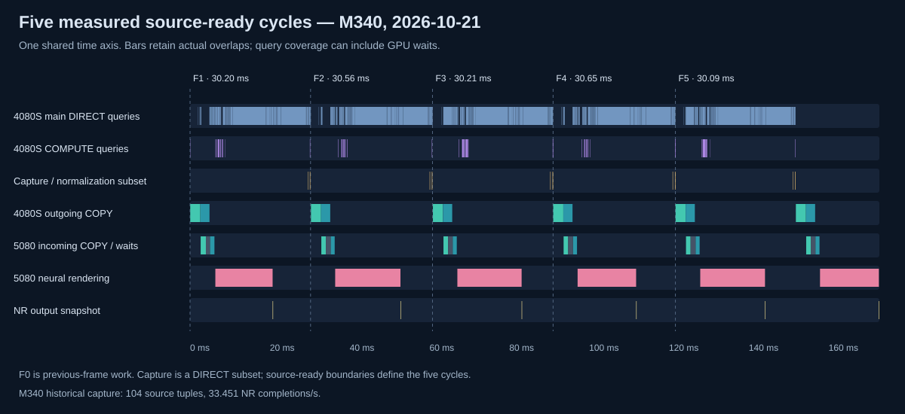

# MGPU for NTE

[中文](README.md) · [Install](docs/nte/INSTALL.zh-CN.md) · [Measurements](docs/nte/PERFORMANCE.zh-CN.md) · [Build](docs/nte/BUILD.md)

An experimental Neverness to Everness adaptation of [Neural Coprocessor](https://github.com/maohgad-web/Neural-coprocessor). The initial release pins **M364 bridge + M363 official-FG helper**.

The RTX 4080 SUPER renders the game and runs its game-side DLSS super resolution. The RTX 5080 receives matched color/depth/motion/camera inputs, runs neural rendering, and uses an independent Streamline/Reflex/PCL process for frame generation and presentation. This helper currently accepts **GeForce RTX 5080 only**; other GPUs and game builds are not claimed supported.

## Changes

- Stabilized same-frame input ownership, frame identities, snapshots and fence-based retirement, including skipped-frame ring-slot alignment.
- Added staged color/depth/motion COPY handoffs so receiving can begin before the complete tuple arrives, while inference still requires all inputs.
- Integrated NVIDIA's official frame-generation runtime in the output helper, with input queue isolation and layered mouse passthrough.

Historical unique neural completions increased from **26.699/s to 33.451/s (~25.3%)** between M339c and M340 + ForceTagging. This is **not an isolated A/B result**: tagging/resource paths and workloads differ. Transport elapsed decreased **7.073 → 6.013 → 5.502ms**; the additional M341 reduction did **not** demonstrate an FPS gain. Later runs still reported approximately 28 base FPS. See the measurement page for the full distinction between source completions, API counts, display events and heavy-instrumentation results.

Sixfold means requesting up to five generated frames per real frame, not sixfold input responsiveness or verified physical scanout. Visible pacing and latency remain imperfect. Post-generation buffering of six completed images is not implemented. M365 was withdrawn; M366/M367 experiments are excluded.

Publication checks passed locally (75 main + 20 helper cases). Two GitHub-hosted runs each passed 74/75 main cases: the fine-capacity recording stress fixture timed out during asynchronous drain. The root cause remains unverified; cloud helper tests were not reached. This limitation is retained publicly, not hidden by skipping the test. See [CI](https://github.com/wc2395082443-del/MGPU-for-NTE/actions/runs/40768218148).

The figure uses a historical measured M340 five-frame window, not an idealized schedule or a measurement of this release. It retains actual timing overlaps and explicitly distinguishes query coverage from exclusive rendering execution.

## Distribution

The release ZIP contains our bridge/helper binaries, example configuration, shader, integrity checks, backup/rollback installer and local runtime import tool. NVIDIA runtime/model binaries, ReShade and game assets are **not redistributed**. Supply the matching dependencies from your own installation; see [dependencies](docs/nte/DEPENDENCIES.md).

Tested game EXE SHA256: `032EB661CE65E0669FB643A2E87E727D5574BBA832CD6FE34FF0AB1D134CD788`. Some integration routes use build-specific guards. This is a ReShade-based modification, not an official NVIDIA/game integration. No anti-cheat bypass is provided.

MIT license and upstream attribution are retained. Maintained by [wc2395082443-del](https://github.com/wc2395082443-del). Exact source/binary provenance and test limits are documented in [PROVENANCE.md](docs/nte/PROVENANCE.md).
