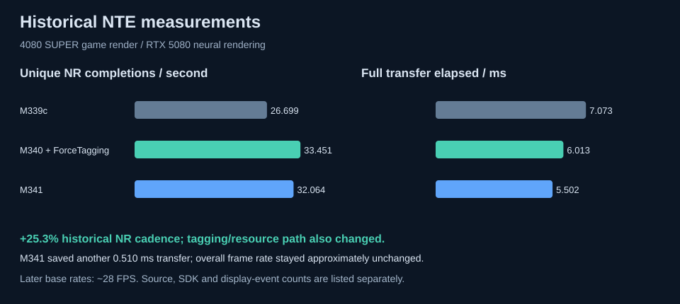
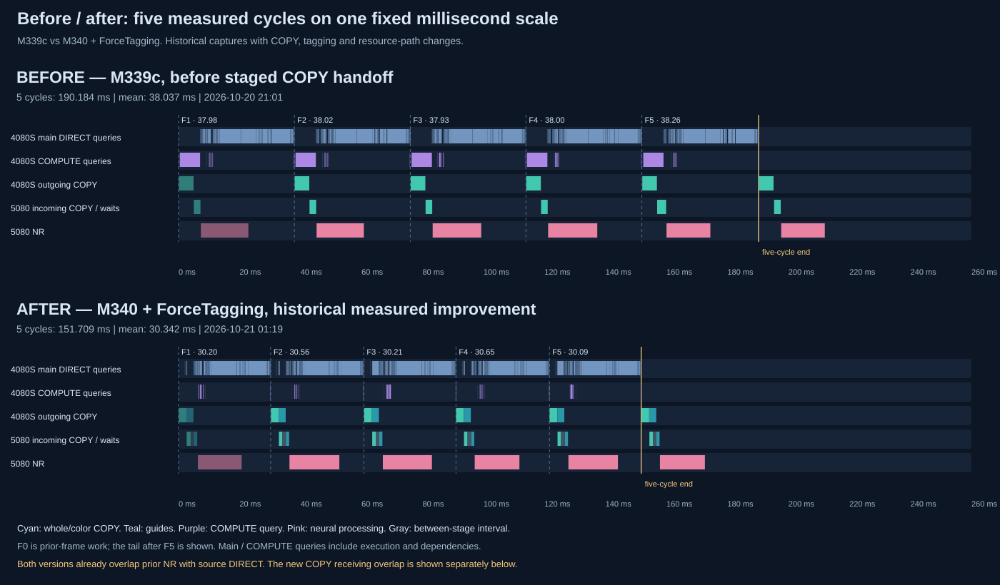
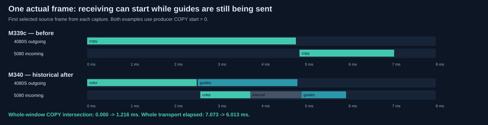

# MGPU for NTE

[中文](README.md) · [Install](docs/nte/INSTALL.zh-CN.md) · [Measurements](docs/nte/PERFORMANCE.zh-CN.md) · [Build](docs/nte/BUILD.md)

An experimental Neverness to Everness adaptation of [Neural Coprocessor](https://github.com/maohgad-web/Neural-coprocessor). The initial release pins **M364 bridge + M363 official-FG helper**.

The RTX 4080 SUPER renders the game and runs its game-side DLSS super resolution. The RTX 5080 receives matched color/depth/motion/camera inputs, runs neural rendering, and uses an independent Streamline/Reflex/PCL process for frame generation and presentation. This release targets the tested NTE build and **GeForce RTX 5080 helper**.

**Sixfold frame generation uses NVIDIA's official DLSS Frame Generation runtime through Streamline/DLSS-G, rather than Lossless Scaling. The user's latest feedback describes the visual result as excellent.** This project connects the NR image and guides to that runtime and manages the output window.

## User-reported gameplay comparison

The user's NTE gameplay and NR-stage figures:

| Setup | Game GPU | NR/FG GPU | Game DLSS mode | FG request | User-reported result |
| --- | --- | --- | --- | --- | --- |
| Before the dual-GPU adaptation | RTX 5080 | None | Ultra Performance | 6x | Approximately 120 |
| Dual-GPU setup | **RTX 4080 SUPER (not RTX 50-series)** | **RTX 5080** | **Quality** | 6x | **User reports stable above 160** |
| Single 4080S, DLSS neural rendering enabled | RTX 4080 SUPER | None | Quality | Off | **Approximately 22 FPS at maximum settings + full ray tracing** |
| Single 4080S, DLSS neural rendering disabled | RTX 4080 SUPER | None | — | Off | **Approximately 40 FPS** |
| RTX 5080 running only NR | — | RTX 5080 | — | — | **Approximately 50 NR frames/s** |

The 4080S records approximately 40 FPS with neural rendering disabled and 22 FPS while running the game and NR together. The 5080-only NR figure describes processing throughput for the neural stage.

These figures were supplied by the user on 2026-10-29, with settings shown in the table. The setup demonstrates a non-50-series primary GPU. The first-release helper supports RTX 5080; other primary and secondary GPUs require adaptation and testing.

## Helper responsibilities and FG overhead

The helper is the RTX 5080's independent official-FG/display endpoint. It validates same-frame NR/depth/motion/camera tuples, manages shared/private resource retirement, relays real source Reflex/PCL markers, submits the official proxy Present and maintains an isolated mouse-passthrough output window and diagnostics. Game rendering and NR complete upstream.

FG runs on the secondary GPU, allowing base throughput to stay approximately unchanged when that GPU has headroom. Historical windows recorded **33.02 unique NR frames/s without FG (M343)** and **33.05 real frames/s with a sixfold request (M351), SDK count 194.85/s**. Base throughput stayed close in these samples. NR and FG share the 5080; copies, synchronization and presentation feedback also use resources.

[Detailed helper documentation](docs/nte/HELPER.zh-CN.md) covers threads, fences, official/manual responsibilities, window/input isolation, rates, compatibility and current limitations. Completed six-image post-FG buffering is not implemented.

## Changes

- Stabilized same-frame input ownership, frame identities, snapshots and fence-based retirement, including skipped-frame ring-slot alignment.
- Added staged color/depth/motion COPY handoffs so receiving can begin before the complete tuple arrives, while inference still requires all inputs.
- Integrated NVIDIA's official frame-generation runtime in the output helper, with input queue isolation and layered mouse passthrough.

Historical unique neural completions increased from **26.699/s to 33.451/s (~25.3%)** between M339c and M340 + ForceTagging, alongside changes to COPY, tagging and resource submission. Transport elapsed decreased **7.073 → 6.013 → 5.502ms**. M341's additional transfer reduction left overall FPS approximately unchanged. Later runs reported around 28 base FPS. The measurement page records versions, sampling conditions and rate definitions.

Sixfold requests up to five generated frames per real frame. Visible pacing and latency remain areas for improvement. Post-generation buffering of six completed images is planned. M365 was withdrawn; M366/M367 experiments remain separate.

Publication checks passed locally (75 main + 20 helper cases). Two GitHub-hosted runs each passed 74/75 main cases: the fine-capacity recording stress fixture timed out during asynchronous drain, stopping the job before helper tests. The cause remains under investigation. See [CI](https://github.com/wc2395082443-del/MGPU-for-NTE/actions/runs/40768218148).

Five source-ready cycles span **190.184ms before (M339c) versus 151.709ms after (M340 + ForceTagging)**, on the same millisecond scale. The figure uses two historical captures. Both overlap neural rendering with source DIRECT work.

The transport change allows color reception while the producer is still sending guides. [Interactive comparison](docs/nte/five-frame-comparison.html) (download and open locally) includes exact tooltips, lane controls, JSON export and a separate M364 + M363 window with detailed collection enabled. See [data selection](docs/nte/COMPARISON.zh-CN.md).

## Distribution

The release ZIP contains our bridge/helper binaries, example configuration, shader, integrity checks, backup/rollback installer and local runtime import tool. NVIDIA runtime/model binaries, ReShade and game assets are **not redistributed**. Supply the matching dependencies from your own installation; see [dependencies](docs/nte/DEPENDENCIES.md).

Tested game EXE SHA256: `032EB661CE65E0669FB643A2E87E727D5574BBA832CD6FE34FF0AB1D134CD788`. Some integration routes use build-specific guards. The project loads through ReShade; compatibility depends on the game build and its anti-cheat policy.

MIT license and upstream attribution are retained. Maintained by [wc2395082443-del](https://github.com/wc2395082443-del). Exact source/binary provenance and test limits are documented in [PROVENANCE.md](docs/nte/PROVENANCE.md).
