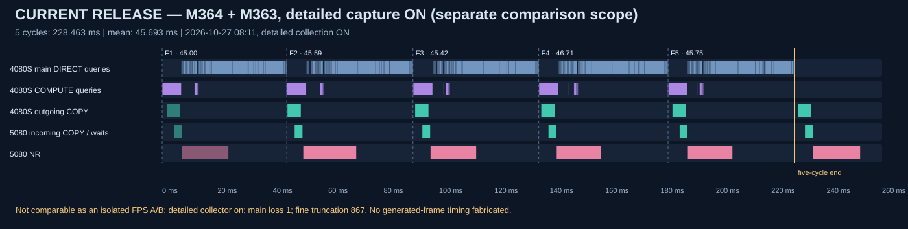

# MGPU for NTE

**异环 / Neverness to Everness 的双卡神经渲染适配分支。**

[English](README.en.md) · [安装说明](docs/nte/INSTALL.zh-CN.md) · [性能与测试边界](docs/nte/PERFORMANCE.zh-CN.md) · [构建](docs/nte/BUILD.md) · [上游](https://github.com/maohgad-web/Neural-coprocessor)

4080 SUPER 负责游戏渲染及游戏自己的 DLSS 超分；RTX 5080 接收同帧颜色、深度、运动矢量和相机数据，执行 DLSS Neural Rendering（本文简称 NR），再由独立 helper 接入官方 Streamline 帧生成和呈现。

首发固定为 **M364 主模块＋M363 helper**。这是研究预览，针对已测试的异环构建和双卡组合，不是 NVIDIA 官方游戏集成，也不是所有游戏、显卡和补丁版本通用。helper 当前明确限制为 **GeForce RTX 5080**。源码保留上游 MIT 许可和署名。

## 用户体验对照：从单卡低档位到双卡高档位

用户于2026-10-29提供的异环 **DLSS5＋全景光追** 体验记录：

| 方案 | 游戏渲染主卡 | NR/FG副卡 | 游戏DLSS | 帧生成 | 用户报告显示帧率 |
| --- | --- | --- | --- | --- | --- |
| 双卡改造前 | RTX 5080 | 无 | 超级性能 | 六倍 | 约120FPS |
| 双卡方案 | **RTX 4080 SUPER（非50系）** | **RTX 5080** | **质量** | 六倍 | **反馈稳定160FPS以上** |

核心体验收益是：**游戏DLSS从超级性能提高到质量档，显示读数从约120提高到160以上，同时主渲染使用非50系4080S。** 这是用户报告，不是本次重新采集的物理扫描FPS；两组画质档位不同，不当作同画质控制A/B，分辨率/场景/驱动未在本次重新核对。

架构把游戏渲染与NR/FG能力分离，**主卡不必是50系**已由4080S验证；但“任意主卡＋任意50系副卡”尚未实现，首发helper代码仅接受5080。其他卡还需资源互通、游戏引导、SDK能力和显示路径适配，见[兼容性范围](docs/nte/HELPER.zh-CN.md#11-兼容性主卡不必是50系副卡当前仍有明确限制)。

## 我们做了什么

| 方向 | 分支中的改动 | 已观察结果 |
| --- | --- | --- |
| 画面稳定 | 同帧引导和身份校验、自有输入/输出快照、按 fence 退休；修复跳帧后环槽身份错位，保留 ForceTagging 资源入口 | M340/M341 实测后，用户确认走动、转镜头时画面稳定；不保证所有场景无伪影 |
| 双卡吞吐 | 专用 COPY 队列、颜色先行接收、深度/运动矢量分阶段交接、保留输入完整性和反向资源保护 | 历史 NR 完成节奏 26.70→33.45/s；跨卡整段传输 7.073→6.013→5.502ms，详情见下方 |
| 帧生成 | 5080 独立进程运行官方 Streamline DLSS-G/Reflex/PCL，最多请求六倍；M362 输入队列解耦、M363 分层鼠标穿透 | 官方六倍配置和隐藏呈现测试通过；显示均匀性与真实输入延迟仍存在限制 |

## helper负责什么，六倍是否影响基础帧

**helper是5080上的独立官方FG与显示端**：接收NR颜色及同帧深度/MV/相机，校验身份，用共享三槽和完成fence交接，复制到私有输入，提交官方FG/Reflex/PCL，并管理独立输出覆盖层、鼠标穿透、速率和诊断。4080S游戏渲染、跨卡COPY及5080 NR都在它之前完成。

主要插帧计算放在5080，不让4080S重渲五张额外场景；在副卡余量足够、无额外反压瓶颈的条件下，基础源帧可以基本维持。历史窗口中，未加FG的M343约**33.02个真实NR帧/s**，六倍M351仍约**33.05个真实帧/s**，SDK报告约**194.85/s**，即这些记录中**未观察到明显基础帧损伤**。这是不同窗口的观察，不是严格FG开关A/B或任何配置零开销的保证。

SDK计数也不能代替可见流畅度：M352仍约33.1真实帧/s、SDK195.2/s，但显示事件节奏恶化，用户确实反馈不如上一版。helper仍有私有COPY、资源退休和源Reflex反馈成本，且官方SDK管理最终呈现。**FG后缓存六张再均匀送屏尚未实现。**

详见 **[helper完整功能、线程、同步、窗口输入及六倍性能说明](docs/nte/HELPER.zh-CN.md)**。

### 性能记录，不把插帧当基础帧


| 测量窗口 | 唯一 NR 完成 /s | 传输 elapsed |
| --- | ---: | ---: |
| 历史 M339c | 26.699 | 7.073ms |
| M340＋ForceTagging | 33.451 | 6.013ms |
| M341 | 32.064 | 5.502ms |

**26.70→33.45/s 是约 25.3% 的历史观测提升，不是严格控制的单变量 A/B。** ForceTagging 和资源提交路径也变化，场景/负载并非完全一致；不能把全部提升归功于 COPY。M341 再省约 0.510ms 传输，那个窗口没有整体提帧。

**当前发布基线也没有保证恢复到 34 基础帧。** 后期用户仍报告约 28；M364＋M363 的重采集窗口为 22.739 源帧/s（详细测量开启），不能用它断言无测量时性能。六倍是最多 5 张生成帧＋1 张真实帧的请求，不是六倍输入响应，也不是保证屏幕物理显示六倍。完整数据、口径和反例均在 [性能页](docs/nte/PERFORMANCE.zh-CN.md)。

## 五帧流水线


**优化前 M339c：五周期190.184ms；历史改进后 M340＋ForceTagging：151.709ms。** 两图使用完全相同的毫秒刻度，保留前一帧尾部和F5之后的后处理。不是严格同场景单变量A/B，不能将全部差异都算成COPY收益。


直接变化是：原来整包发完再接收；改进后可在发送深度/运动矢量时，5080已经接收颜色。两版原先就有NR与游戏DIRECT重叠，不能称“原来全串行、现在全并行”。

[下载离线交互对比图](docs/nte/five-frame-comparison.html) · [数据选择与限制](docs/nte/COMPARISON.zh-CN.md) · [原M340单图](docs/nte/five-frame-timeline.html)。HTML下载后本地打开，支持悬停、轨道/F0/边界开关和数据导出。

<details>
<summary>首发M364＋M363的独立五帧实测（详细采集开启，不用于收益归因）</summary>



该窗口五周期228.463ms，测量负载与历史窗口不同；整轮main记录丢1条，867个fine任务截断。它不冒充历史33.45/s窗口，也不能直接用来推断未开详细测量的版本退化。没有可验证的六张生成帧扫描时标，故不伪造六条显示帧。

</details>

另见 [架构与改动](docs/nte/ARCHITECTURE.zh-CN.md)。

## 下载与安装

从本 fork 的 Releases 下载 `MGPU-for-NTE-M364-M363-preview.zip`，按 [安装步骤](docs/nte/INSTALL.zh-CN.md)执行。包包含我们的主模块、helper、配置模板、深度 shader、校验清单和可回退安装脚本。

NVIDIA NR 模型、NGX/Streamline 运行库、ReShade、游戏文件不打进安装包。通过 `Import-Runtime.ps1` 从用户自己的安装导入匹配运行库，避免错版本混装；文件缺失时明确报错，不假装装完即可工作。

## 当前边界

- 已知异环 EXE SHA256：`032EB661CE65E0669FB643A2E87E727D5574BBA832CD6FE34FF0AB1D134CD788`。部分原生接口有版本校验，游戏更新需重新适配。
- 本分支通过 ReShade 加载，并创建 5080 输出覆盖层。兼容性和反作弊策略由游戏决定；本项目不绕过或禁用反作弊。
- 游戏菜单插帧关闭是测试基线；源 SDK 曾观察到不同内部请求，原因不能归咎用户。首次发布不带 M366/M367 的源端停用实验。
- 游戏主 DIRECT 与 COPY 并非已证明全面重叠，后期捕获仍显示依赖；不宣称双卡达到理想 `max(stage)` 帧周期。
- 官方 SDK 管理生成帧呈现；**FG 后缓存六帧再均匀输出尚未实现**。已撤回的 M365 入口前等待不包含在发布版。
- M366 有更流畅的用户反馈，随后又收到程序异常报告并回退；根因未证实。M367 仅软件候选，首发均不包含。
- 发布源码在本地通过75项主工程＋20项helper测试；[GitHub托管环境两次验证](https://github.com/wc2395082443-del/MGPU-for-NTE/actions/runs/40768218148)均为主工程74/75，一项采集压力测试异步排空超时。问题尚未归因，不标成全绿，也不修改选定的发布二进制来掩盖它。

## 开发与来源

发布二进制 SHA256：

```text
M364 nvngx.dll_mgpu_bridge.addon64
3A6C8FF99FD5D1361A07A9D5D91CE8164326BEDF5521B5151CE886F53BC73D59
M363 mgpu-official/mgpu_official_host.exe
21B70B40195D264E2679D652B0F14A1C0E005F2E95EAF9334F339BE4309B1264
```

[构建与验证](docs/nte/BUILD.md) · [发布来源](docs/nte/PROVENANCE.md) · [第三方依赖](docs/nte/DEPENDENCIES.md) · [上游原 README](docs/nte/UPSTREAM_README.md)

原项目由 Marcelo Guibout 及上游贡献者开发；本 fork 由 [wc2395082443-del](https://github.com/wc2395082443-del)维护异环适配和测量改进。所有测试结果均只属于注明的硬件、版本和窗口，不将上游其他机器的成绩当作本分支实测。
