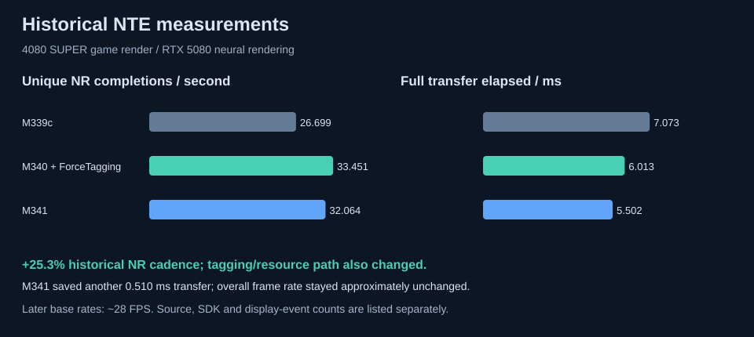
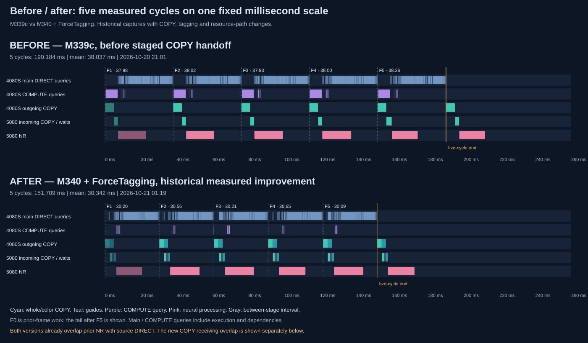
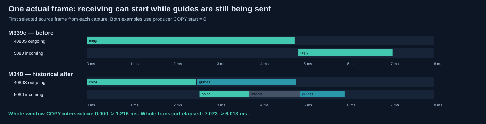
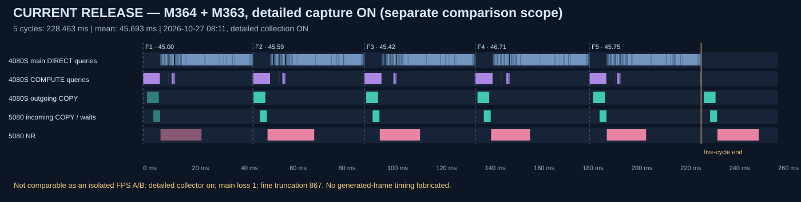

# MGPU for NTE

**异环 / Neverness to Everness 的双卡神经渲染适配分支。**

[English](README.en.md) · [安装说明](docs/nte/INSTALL.zh-CN.md) · [性能与测试边界](docs/nte/PERFORMANCE.zh-CN.md) · [构建](docs/nte/BUILD.md) · [上游](https://github.com/maohgad-web/Neural-coprocessor)

4080 SUPER 负责游戏渲染及游戏自己的 DLSS 超分；RTX 5080 接收同帧颜色、深度、运动矢量和相机数据，执行 DLSS Neural Rendering（本文简称 NR），再由独立 helper 接入官方 Streamline 帧生成和呈现。

当前预览版为 **2026-11-09 并行流水线与低延迟版 preview.3**，采用已安装并逐阶段确认正常的主模块`8ADEAA05`＋helper`446FD260`。**4080S关闭游戏进程里的源端帧生成，5080在NR之后运行NVIDIA官方帧生成，最多请求六倍。** helper当前支持GeForce RTX 5080，源码保留上游MIT许可和署名。

[新版改动与验证记录](docs/nte/PIPELINE-UPDATE.zh-CN.md)：更新游戏构建识别，恢复拍照／菜单后的FG，清理过期覆盖画面；加入三额度并行背压、Reflex Sleep前的容量等待和双Pass异步处理。用户确认登录／双Pass不闪、延迟低，三个测量清理阶段均正常。保留同帧引导、资源同步和输入隔离，旧版[源FG关闭记录](docs/nte/SOURCE-FG-OFF.zh-CN.md)继续留存。其他50系副卡仍为[独立兼容候选](docs/nte/RTX50-COMPAT.zh-CN.md)。

**六倍帧生成使用 NVIDIA 官方 DLSS 多帧生成，通过官方 Streamline／DLSS-G 在5080上运行，并非 Lossless Scaling（小黄鸭）插帧。用户最新体验反馈：画面效果非常好。** 本项目负责NR画面与引导交接、官方SDK接线和输出窗口。

## 性能对照：单卡、双卡优化与六倍帧生成

用户于2026-10-29提供的异环游戏体验与NR分工记录：

### 1. 单卡与分工参考

| 硬件 | 工作负载 | 用户记录 |
| --- | --- | --- |
| RTX 4080 SUPER | 游戏渲染，关闭DLSS5 | **约40FPS** |
| RTX 4080 SUPER | 游戏＋DLSS5，DLSS质量、全景光追、最高画质 | **约22FPS** |
| RTX 5080 | 仅执行NR阶段 | **约50个NR帧/s** |

4080S关闭DLSS5时约40FPS，单卡同时承担游戏和DLSS5时约22FPS；5080仅做NR的阶段处理速度约50帧/s。

### 2. 双卡DLSS5优化前后：基础帧

| 双卡分工 | 优化前 | 优化后 |
| --- | ---: | ---: |
| **4080S主渲染＋5080执行NR** | **约28FPS** | **约34FPS** |

这组优化阶段记录中，基础帧提高约**21.4%**。

### 3. 加入NVIDIA官方六倍帧生成：游戏体验

| 方案 | 游戏渲染主卡 | NR/FG副卡 | 游戏DLSS | 帧生成 | 用户报告显示帧率 |
| --- | --- | --- | --- | --- | --- |
| 单卡5080 | RTX 5080 | 无 | 超级性能 | 六倍 | 约120FPS |
| **双卡方案** | **RTX 4080 SUPER（非50系）** | **RTX 5080** | **质量** | 六倍 | **稳定160FPS以上** |

**游戏DLSS从超级性能提高到质量档，显示帧率从约120提高到160以上，同时主渲染使用非50系4080S。**

架构把游戏渲染与NR/FG能力分离，**主卡不必是50系**已由4080S验证；但“任意主卡＋任意50系副卡”尚未实现，首发helper代码仅接受5080。其他卡还需资源互通、游戏引导、SDK能力和显示路径适配，见[兼容性范围](docs/nte/HELPER.zh-CN.md#11-兼容性主卡不必是50系副卡当前仍有明确限制)。

## 我们做了什么

| 方向 | 分支中的改动 | 已观察结果 |
| --- | --- | --- |
| 画面稳定 | 同帧引导和身份校验、自有输入/输出快照、按 fence 退休；修复跳帧后环槽身份错位，保留 ForceTagging 资源入口 | M340/M341 实测后，用户确认走动、转镜头时画面稳定 |
| 双卡吞吐 | 专用 COPY 队列、颜色先行接收、深度/运动矢量分阶段交接、保留输入完整性和反向资源保护 | 历史 NR 完成节奏 26.70→33.45/s；跨卡整段传输 7.073→6.013→5.502ms，详情见下方 |
| 帧生成 | 5080 独立进程运行官方 Streamline DLSS-G/Reflex/PCL，最多请求六倍；M362 输入队列解耦、M363 分层鼠标穿透 | 官方六倍配置和隐藏呈现测试通过；显示均匀性与真实输入延迟仍存在限制 |
| 源端FG停用 | 拦截游戏源`slDLSSGSetOptions`，在构建和实时ForceTagging保护下仅将mode转为Off；5080 helper入口不变 | 前台源SDK Off与NR输出已核对；旧约7ms区间未在新后台窗口记录到，前台六倍GPU对照仍待完成 |
| 慢端匹配与低延迟 | 三个在途额度，满时等最老任务，保留跨帧并行；容量等待提前到原生Reflex Sleep之前 | 用户确认登录与双Pass不闪，延迟低 |
| 双Pass流畅度 | 官方双Pass进入已有三槽异步NR路径，两遍评估及画质参数保留 | 用户确认体验良好 |
| 恢复与测量清理 | 拍照／菜单源标记恢复、旧覆盖过期、环槽回收；分三阶段关闭可选测量 | 三阶段均获用户正常反馈；部分功能耦合计数和日志仍保留 |

## helper负责什么，六倍是否影响基础帧

**helper是5080上的独立官方FG与显示端**：接收NR颜色及同帧深度/MV/相机，校验身份，用共享三槽和完成fence交接，复制到私有输入，提交官方FG/Reflex/PCL，并管理独立输出覆盖层、鼠标穿透和存活保护。当前关闭其可选追踪及纯速率统计，必要SDK状态仍有效。4080S游戏渲染、跨卡COPY及5080 NR都在它之前完成。

主要插帧计算放在5080。副卡余量足够时，基础源帧可以基本维持：历史M343约**33.02个真实NR帧/s**，开启六倍的M351约**33.05个真实帧/s**，SDK报告约**194.85/s**。这些窗口中，基础帧基本持平。

M352也记录到33.1真实帧/s、SDK195.2/s，但显示节奏变差，用户反馈不如上一版。helper的私有COPY、资源退休和源Reflex反馈仍有开销；最终呈现由官方SDK管理。**FG后缓存六张再均匀送屏仍在开发计划中。**

详见 **[helper完整功能、线程、同步、窗口输入及六倍性能说明](docs/nte/HELPER.zh-CN.md)**。

### 性能记录



| 测量窗口 | 唯一 NR 完成 /s | 传输 elapsed |
| --- | ---: | ---: |
| 历史 M339c | 26.699 | 7.073ms |
| M340＋ForceTagging | 33.451 | 6.013ms |
| M341 | 32.064 | 5.502ms |

**历史NR吞吐从26.70提高到33.45/s，提升约25.3%。** 期间同时调整了COPY、ForceTagging和资源提交路径。M341又缩短约0.510ms传输，那个窗口的整体帧率基本未改善。

后期记录的基础帧约28；M364＋M363在开启详细测量时记录22.739源帧/s。六倍模式最多为每张真实帧增加5张生成帧，实际输出受SDK策略和显示链路影响。各版本、采样条件和计数方式见[性能页](docs/nte/PERFORMANCE.zh-CN.md)。

## 五帧流水线



**优化前 M339c：五周期190.184ms；改进后 M340＋ForceTagging：151.709ms。** 两次历史采样使用相同毫秒刻度，保留前一帧尾部和F5之后的后处理。



原来整包发完再接收；改进后，4080S发送深度/运动矢量时，5080已经开始接收颜色。两版均保留NR与游戏DIRECT的重叠。

[下载离线交互对比图](docs/nte/five-frame-comparison.html) · [数据选择与限制](docs/nte/COMPARISON.zh-CN.md) · [原M340单图](docs/nte/five-frame-timeline.html)。HTML下载后本地打开，支持悬停、轨道/F0/边界开关和数据导出。

<details>
<summary>首发M364＋M363的独立五帧实测（详细采集开启，不用于收益归因）</summary>



该窗口五周期228.463ms，详细测量开启；整轮main记录丢1条，867个fine任务截断。图中展示已记录的游戏队列、COPY和NR时间。

</details>

另见 [架构与改动](docs/nte/ARCHITECTURE.zh-CN.md)。

## 下载与安装

从 [最新预览发布](https://github.com/wc2395082443-del/MGPU-for-NTE/releases/tag/nte-pipeline-preview.3)下载`MGPU-for-NTE-pipeline-preview.3.zip`，按[安装步骤](docs/nte/INSTALL.zh-CN.md)执行。包包含本次主模块和helper、配置模板、深度shader、校验清单和可回退安装脚本。前两版Release保留。

NVIDIA NR 模型、NGX/Streamline 运行库、ReShade、游戏文件不打进安装包。通过 `Import-Runtime.ps1` 从用户自己的安装导入匹配运行库，避免错版本混装；文件缺失时明确报错，不假装装完即可工作。

## 当前边界

- 已知异环 EXE SHA256：`E72655E227E17796D13EDF00F827DDFEBDE9859B3D758858F0FFC82765D84EFE`。部分原生接口有版本校验，游戏更新需重新适配。
- 本分支通过 ReShade 加载，并创建 5080 输出覆盖层。兼容性和反作弊策略由游戏决定；本项目不绕过或禁用反作弊。
- 游戏菜单插帧关闭是测试基线；本版处理与菜单不一致的源SDK请求，保留5080 helper官方六倍。源SDK关闭后，已有代理swapchain仍可能保留离屏复制/同步，尚未重建游戏swapchain。
- 游戏主DIRECT与COPY之间仍有队列依赖，是后续调度优化的方向。
- 官方 SDK 管理生成帧呈现；**FG 后缓存六帧再均匀输出尚未实现**。已撤回的 M365 入口前等待不包含在发布版。
- M366 有更流畅的用户反馈，随后又收到程序异常报告并回退；根因未证实。M367 仅软件候选，首发均不包含。
- 当前相关回归14项主测试＋11项helper通过；发布验证见[构建记录](docs/nte/BUILD.md)。旧preview.2云端76/77主测试结果及既有WARP排空超时单独保留。本次没有新增同条件FPS或端到端延迟测量。
- 大规模GPU／CPU流水线采集在本发布关闭；MetaProbe、PresentAudit、PanelStats及部分状态计数、日志和旧条件读回仍保留。面板部分诊断／速率字段停止更新。

## 开发与来源

发布二进制 SHA256：

```text
pipeline-preview.3 nvngx.dll_mgpu_bridge.addon64
8ADEAA052261EA7C89DC6AB3137496B13A5A57D3D7B54F3CE98C776737987E48
helper-measurement-stage3 mgpu-official/mgpu_official_host.exe
446FD26095FCB21EEB446D06F67E18485BCEE3D4C432D6B7A3BBB841C9DE6933
```

[构建与验证](docs/nte/BUILD.md) · [发布来源](docs/nte/PROVENANCE.md) · [第三方依赖](docs/nte/DEPENDENCIES.md) · [上游原 README](docs/nte/UPSTREAM_README.md)

原项目由 Marcelo Guibout 及上游贡献者开发；本 fork 由 [wc2395082443-del](https://github.com/wc2395082443-del)维护异环适配和测量改进。测试硬件、版本和采样窗口随数据记录。
