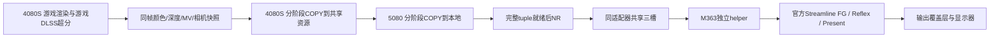

# 架构与三类改进

### 画面稳定

颜色、深度、运动矢量与相机常量使用一致身份，accepted seal与槽位统一；不以“过去几帧了”代替资源完成。独立输入/输出快照、源端退休、消费端输入处理完成fence避免覆盖正在读取的纹理。ForceTagging保留游戏原生引导入口；正确标签不等于引擎原生像素流完全验证，NR修改后仍可能产生重建/FG伪影。

### 双卡吞吐

颜色先发送/接收，深度与运动矢量分别交接，完整tuple最终才准入NR。共享COPY与下一阶段可重叠，环槽按fence回收。M364恢复M358之前源环预取行为，移除前置两帧预算，保留下游真实背压；不删除保护围栏。

历史COPY缩短已测到，当前游戏主DIRECT仍可能被源侧SDK/其他队列依赖阻塞。因此不能声称只要两张卡存在就必然达到最慢单阶段帧率。

### 官方帧生成与输入

helper在5080建立独立Streamline代理swapchain，传同帧资源和Reflex/PCL标记，生成及最终Present由官方SDK管理。M362将输出窗口与游戏输入队列拆开，M363使用layered＋transparent并初始化alpha255保持鼠标穿透；不伪造鼠标/按钮/滚轮事件。

现有helper不是FG后六纹理队列；官方Present同时包含生成与呈现。后级缓存再均匀送屏需要另一套生成输出所有权方案，首发未包含。源帧抖动、DWM合成、显示刷新率和FG策略都会影响可见节奏。
