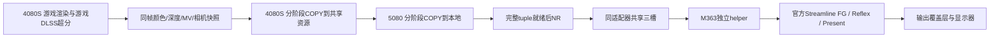

# 架构与三类改进

preview.2：**4080S源端FG关闭，5080在NR后运行官方FG**。主模块只在原游戏线程的源选项入口改modeOff，保留标签、Reflex、同帧引导和所有资源fence；helper动态MFG最多六倍、目标200 FPS。详见[实现与验收](SOURCE-FG-OFF.zh-CN.md)。

### 画面稳定

颜色、深度、运动矢量和相机常量使用一致身份，accepted seal与槽位统一。独立输入/输出快照和双向fence保护正在读取的纹理，ForceTagging保留原生引导入口。NR重建和FG仍可能出现伪影。

### 双卡吞吐

颜色先发送/接收，深度与运动矢量分别交接，完整tuple最终才准入NR。共享COPY与下一阶段可重叠，环槽按fence回收。M364恢复M358之前源环预取行为，移除前置两帧预算，保留下游真实背压；不删除保护围栏。

历史COPY耗时已缩短；当前主DIRECT与源侧SDK/其他队列的依赖仍是调度优化方向。

### 官方帧生成与输入

helper在5080建立独立Streamline代理swapchain，传同帧资源和Reflex/PCL标记，生成及最终Present由官方SDK管理。M362将输出窗口与游戏输入队列拆开，M363使用layered＋transparent并初始化alpha255保持鼠标穿透；不伪造鼠标/按钮/滚轮事件。

当前由官方Present管理生成和呈现。FG后缓存六张再均匀送屏属于后续开发，需要增加生成输出的接管路径。源帧抖动、DWM合成、刷新率和FG策略都会影响显示节奏。

完整功能、线程分工、三层fence、窗口穿透、六倍性能和兼容性见 **[HELPER.zh-CN.md](HELPER.zh-CN.md)**。该文同时区分用户新增的“单5080超级性能约120显示FPS、双卡4080S＋5080质量档稳定160以上”体验记录，以及可解析的源帧/SDK/显示事件历史测量。
