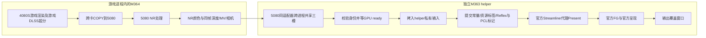

# M363 helper 详细功能：5080上的独立帧生成与显示端

本文对应首发 **M364主模块＋M363 `mgpu_official_host.exe`**。helper接到的是5080已经处理好的NR画面及其同帧引导；游戏场景渲染和NR处理在上游完成。

## 1. 为什么需要独立进程

异环主进程的D3D12设备、Streamline状态及原生游戏交换链属于游戏所在适配器。5080输出NR后，还需要接上对应设备的FG、Reflex和代理Present。

helper在5080建立独立D3D12设备、呈现队列、官方Streamline运行时和输出交换链，把NR结果接入这条显示链。官方SDK负责生成与呈现，helper负责数据、窗口和生命周期；两进程通过共享资源和同步通道协作。

这里有**两种传输**：4080S→5080的跨卡传输在M364；5080 NR进程→helper则使用同一适配器上的GPU跨进程共享。

## 2. 接收什么，怎样防止串帧

每次交接包含3张资源和一份描述：

| 输入 | 用途 |
| --- | --- |
| NR处理后的颜色 | 真实输入画面，复制到官方交换链当前backbuffer |
| 对应深度 | FG需要的几何遮挡引导 |
| 对应运动矢量 | FG需要的运动引导 |
| 相机/常量与身份 | 矩阵、抖动、运动尺度、近远平面、reset、viewport、源帧ID、共享generation和序号 |

资源通过共享句柄打开；metadata通过共享内存通道和事件通知。helper校验generation、顺序、同帧颜色/深度/MV/相机身份，以及NR输出和相机有效标记。格式、尺寸或协议错误时停止该输出路径。

源帧跳跃时，主模块为历史重建设置reset。分辨率或格式变化需要排空并建立新一代资源；首发并没有实现所有动态重建场景的无缝恢复。

## 3. 三槽和三层资源保护

三槽保存**三个轮转的源输入tuple**，每槽包含颜色、深度、运动矢量及相应元数据。

| 保护 | 谁负责 | 何时允许复用 |
| --- | --- | --- |
| NR导出ready fence | M364→helper | 5080确实写完对应共享tuple后，helper队列才可读取 |
| 共享输入released fence | helper→M364 | helper已经把共享tuple复制到自己的私有资源后，主模块才可覆盖共享槽 |
| 私有输入官方消费fence＋命令退休fence | helper/官方SDK | 官方不再读旧引导、helper旧命令也退休后，才能覆写私有输入或重置allocator |

helper完成共享输入到私有资源的复制后即可归还共享槽。私有输入继续由SDK消费，通过另一组fence管理退休。槽位不足或旧命令未完成时，相关阶段会等待。

## 4. 官方FG接线和六倍模式

**生成算法和运行库使用NVIDIA官方DLSS帧生成，接入官方Streamline／DLSS-G，并非Lossless Scaling（小黄鸭）。** 用户于2026-10-29的最新评价是“效果非常好”。本项目的工作是连接NR输入、同帧引导、Reflex/PCL和显示窗口。

helper加载并校验NVIDIA签名的Streamline模块，启用DLSS-G、Reflex、PCL。在5080建立代理device/factory/queue/swapchain，使用真实源帧token、正确常量和资源标签，调用官方代理 `Present(0,0)`。

按当前策略，2–5倍使用固定模式，6倍选择官方**动态MFG**；`dynamicTargetFrameRate=0`由SDK结合显示器策略选择目标。实际生成数量随SDK策略调整；能力不满足时返回错误。

**官方SDK负责生成和呈现节拍。** `numFramesActuallyPresented`提供SDK呈现计数，输入处理完成fence用于资源退休。“FG后缓存一组六帧，再均匀送屏”仍在开发计划中，需要增加生成输出的接管路径。

## 5. Reflex/PCL与真实源帧的配对

主模块从游戏原生调用路径取得真实源帧的Sleep、Simulation、Render等标记，经独立线程中继。helper把Simulation和输入ping转交SDK，并记录自己的导入、提交和Present阶段。

它保留与三槽相关源帧的历史标记，避免源帧在NR/跨卡阶段延后时，标记已被新帧滚动覆盖。进入呈现前要求对应真实Simulation就绪；缺失时超时失败，不靠补造时间戳继续。

M364源Sleep中继会等待helper完成相应串行号，并设置超时；呈现队列和私有资源也有安全等待。这些反馈可能反压上游。当前source age记录从捕获到代理Present返回的时间，端到端输入延迟测量仍待补充。

## 6. 线程分工

| 执行部分 | 主要工作 |
| --- | --- |
| helper主呈现循环 | 按序接收metadata、检查源标记、准备资源、提交官方Present、更新指标 |
| source relay线程 | 消费源标记、调用源关联Reflex Sleep/PCL、维护源历史并回报完成 |
| 输出UI线程 | 窗口消息、位置/DPI/前台可见性；与可能阻塞的Present分开 |
| 诊断写出线程 | 在启用对应采样时后台写CPU阶段/流水线记录 |

事件和fence协调数据、资源与停止流程。UI线程约16ms检查一次窗口消息；生成帧节拍由官方SDK管理。

## 7. 输出覆盖层和鼠标输入

helper创建自己的无边框popup覆盖游戏客户区。用户仍操作原游戏，helper窗口只用于显示。M362移除了跨进程父子/owner关系，避免两套UI队列耦合；M363加入分层窗口与明确alpha初始化，补上鼠标穿透契约。

目前窗口使用无parent/owner、`WS_DISABLED`、`WS_EX_NOACTIVATE`、tool window、topmost，以及 **layered＋transparent＋alpha255**。画面保持全不透明，鼠标命中交给底层游戏；按钮、滚轮和光标继续由游戏处理。

UI线程跟随原游戏客户区位置和DPI；原游戏可见、非最小化、处于前台且视图路由允许时显示。Home/F7的视图切换由主模块处理。切到input后覆盖层隐藏，helper仍可在后台继续消费输入和调用SDK。

## 8. 计数、浮层与测量

helper每秒更新源Present数量、SDK报告数量、倍率比、可见状态和source age，通过共享通道提供给主面板；可见窗口与后台窗口分开记录。自带画面角标已移除，保留第三方RTSS只挂helper的方案；主游戏/启动链的RTSS排除由用户配置，本程序不自动全局改动。

| 指标 | 定义 | 测量终点 |
| --- | --- | --- |
| `real_presents` / source rate | helper处理的真实NR源帧数量和速率 | helper呈现调用 |
| `sdk_presents` / SDK rate | SDK自报呈现数量和速率 | SDK状态查询 |
| source age | 原捕获时间到代理Present返回的年龄 | 代理Present返回 |
| PresentMon显示事件 | OS呈现路径及变化间隔 | 系统显示事件；生成/真实帧分类取决于驱动支持 |

CPU阶段trace和流水线记录由对应事件触发；常驻计时与日志持续运行。性能记录会注明详细采集是否开启，M364的120秒记录属于重采集窗口。

## 9. 生命周期与出错保护

主模块创建共享通道、只继承必要句柄、启动helper并用job管理其生命周期。helper有心跳；主进程退出或停止事件到达后应停止。设备丢失、协议/源帧错位、资源退休超时、原生标记缺失、SDK错误等会结束官方输出并报告状态。

FG输出故障时，主模块保留NR路径并选择回退显示。helper线程或GPU排空超时时会终止helper；资源退休状态不明确时，主模块保留共享分配。共享generation和尺寸变化的恢复仍需完善。

## 10. 六倍FG的性能：为什么源帧能基本维持

六倍FG主要在5080执行。5080余量足够、资源交接顺畅时，显示帧可以增加，真实NR源帧节奏基本维持。

NR与FG共享5080的计算和显存带宽。额外开销还包括私有输入COPY、共享导出、窗口合成、Reflex反馈及fence等待。

### 历史源帧与SDK记录

| 窗口 | FG | 真实源/NR节奏 | SDK报告节奏 | 显示事件 |
| --- | --- | ---: | ---: | --- |
| M343，100个tuple | 关闭 | 33.020313/s | — | 此处不作显示对照 |
| M351，20秒前台 | 六倍请求 | 33.05/s | 194.85/s | 190.412事件/s，IndependentFlip；非逐像素验证 |
| M352，20秒前台 | 六倍请求 | 33.1/s | 195.2/s | 88.219事件/s，ComposedFlip；用户反馈更不流畅 |

历史窗口中，**开启六倍后真实源帧仍保持约33/s，基础帧基本持平**。M352同时出现了高SDK计数和显示节奏恶化，记录中分别列出了源帧、SDK计数和显示事件。

### 用户新增的整机体验对照

用户于2026-10-29提供以下体验记录，未在本次说明中重新采样：

| 方案 | 游戏渲染主卡 | NR/FG副卡 | 游戏DLSS档位 | FG请求 | 用户报告显示帧率 |
| --- | --- | --- | --- | --- | --- |
| 双卡改造前 | RTX 5080 | 无 | 超级性能（Ultra Performance） | 六倍 | DLSS5＋全景光追下约120FPS |
| 双卡方案 | **RTX 4080 SUPER（非50系）** | RTX 5080 | **质量（Quality）** | 六倍 | 同类玩法下反馈稳定160FPS以上 |

用户的体验收益是**更高DLSS档位＋更高显示帧率，同时把游戏渲染交给非50系4080S**。120和160以上来自2026-10-29的游戏体验反馈，两组分别采用超级性能和质量档。

## 11. 兼容性：主卡不必是50系，副卡当前仍有明确限制

**架构将游戏渲染卡与NR/FG能力卡分离**，所以不要求游戏渲染主卡具备RTX50系的MFG能力。4080S主渲染＋5080副卡就是已测试例子，这是本方案与5080单卡挤在一起运行的关键区别。

| 范围 | 当前能确认的说法 |
| --- | --- |
| 主卡 | 4080 SUPER已测；其他卡需满足D3D12资源/格式、跨卡互通、游戏与引导路径要求 |
| 副卡 | 当前M363代码仅接受名称为`NVIDIA GeForce RTX 5080`的适配器 |
| 更广的50系副卡 | 是可继续适配的架构方向；需要取消/泛化机型限制并验证SDK能力、显存与驱动/呈现路径，首发尚未做到 |
| 其他游戏/新游戏版本 | 需要检查资源标签、原生接口和窗口行为，再适配对应构建 |

**当前已验证非50系主卡4080S＋5080副卡。** 后续可继续适配其他渲染卡和具备所需SDK能力的50系副卡。

## 12. 对应源码

| 文件 | 职责 |
| --- | --- |
| [official_bridge.cpp](../../experimental/official_fg/official_bridge.cpp) | 游戏进程侧启动/通道/导出/标记中继与故障状态 |
| [official_host.cpp](../../experimental/official_fg/official_host.cpp) | helper源历史中继、私有输入、呈现循环与退休 |
| [official_runtime.cpp](../../experimental/official_fg/official_runtime.cpp) | 独立5080 SDK/device/代理swapchain、Reflex/PCL和FG选项 |
| [shared_frame_contract.hpp](../../experimental/official_fg/shared_frame_contract.hpp) | 三槽、同帧身份、序号与生产/消费契约 |
| [shared_frame_transport.cpp](../../experimental/official_fg/shared_frame_transport.cpp) | 同适配器跨进程资源句柄、COPY与ready/released fence |
| [output_window.hpp](../../experimental/official_fg/output_window.hpp) | 独立UI线程、分层穿透覆盖层和可见性维护 |
| [reflex_contract.hpp](../../experimental/official_fg/reflex_contract.hpp) | 哪些源标记中继，哪些由helper自己的真实阶段产生 |
| [official_metrics.hpp](../../experimental/official_fg/official_metrics.hpp) | 源/SDK速率、可见状态及source age口径 |
| [output_trace.hpp](../../experimental/official_fg/output_trace.hpp) | 可触发的CPU阶段与流水线诊断 |
| [fg_mode_policy.hpp](../../experimental/official_fg/fg_mode_policy.hpp)、[probe_policy.hpp](../../experimental/official_fg/probe_policy.hpp) | 倍率模式和RTX5080机型限制 |

配套数据见[FG性能记录](evidence/fg-performance.json)。
