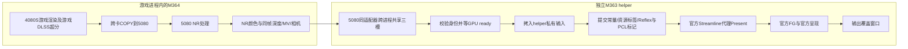

# M363 helper 详细功能：5080上的独立帧生成与显示端

本文对应首发 **M364主模块＋M363 `mgpu_official_host.exe`**，不是后来未发布的候选实现。helper接到的是5080已经处理好的NR画面及其同帧引导，它不承担4080S的游戏场景渲染，也不执行NR本身。

## 1. 为什么需要独立进程

异环主进程的D3D12设备、Streamline状态及原生游戏交换链属于游戏所在适配器。只将5080的NR输出贴回游戏窗口，并不会自动获得5080上的完整官方FG/Reflex/代理Present集成。

helper在5080重新建立独立D3D12设备、呈现队列、官方Streamline运行时和输出交换链，把NR结果接入这条显示链。这样保留官方生成算法和官方呈现逻辑，同时避免在游戏自己的Streamline实例里混用两套设备/窗口状态。独立进程提供生命周期隔离，但不意味着GPU、输入或同步成本完全隔离。

这里有**两种不同传输**：4080S→5080的跨卡传输在M364；5080 NR进程→5080 helper的交接是同一适配器上的跨进程共享，不是再把整套图像走一遍4080S链路，也不是CPU读回图像。

## 2. 接收什么，怎样防止串帧

每次交接包含3张资源和一份描述：

| 输入 | 用途 |
| --- | --- |
| NR处理后的颜色 | 真实输入画面，复制到官方交换链当前backbuffer |
| 对应深度 | FG需要的几何遮挡引导 |
| 对应运动矢量 | FG需要的运动引导 |
| 相机/常量与身份 | 矩阵、抖动、运动尺度、近远平面、reset、viewport、源帧ID、共享generation和序号 |

资源通过共享句柄打开；小型metadata通过共享内存通道和事件通知。helper检查generation、顺序、颜色/深度/MV/相机的源帧身份相同，要求是NR输出、相机有效、不是把已有生成帧再次当真实源输入。格式/尺寸/协议不符合时拒绝继续，不用上一帧引导冒充。

源帧跳跃时，主模块为历史重建设置reset。分辨率或格式变化需要排空并建立新一代资源；首发并没有实现所有动态重建场景的无缝恢复。

## 3. 三槽和三层资源保护

三槽表示**三个源输入tuple的轮转位置**，不是“三张生成帧”，更不是已经持有六张可独立显示的成品图。

| 保护 | 谁负责 | 何时允许复用 |
| --- | --- | --- |
| NR导出ready fence | M364→helper | 5080确实写完对应共享tuple后，helper队列才可读取 |
| 共享输入released fence | helper→M364 | helper已经把共享tuple复制到自己的私有资源后，主模块才可覆盖共享槽 |
| 私有输入官方消费fence＋命令退休fence | helper/官方SDK | 官方不再读旧引导、helper旧命令也退休后，才能覆写私有输入或重置allocator |

因此，helper不会在每个真实帧都等待“屏幕已经显示完所有插帧”后才归还共享输入；它把共享输入生命周期与官方消费私有输入的生命周期分开。仍然存在真实依赖、槽位背压和CPU等待，不应宣传为完全异步或没有同步。

## 4. 官方FG接线和六倍模式

helper加载并校验NVIDIA签名的Streamline模块，启用DLSS-G、Reflex、PCL。在5080建立代理device/factory/queue/swapchain，使用真实源帧token、正确常量和资源标签，调用官方代理 `Present(0,0)`。

按当前策略，2–5倍使用固定模式，6倍选择官方**动态MFG**；`dynamicTargetFrameRate=0`由SDK结合显示器策略选择目标。六倍是请求上限/模式，不保证每个真实帧都恰好呈现六张。SDK能力不满足时明确失败，不静默降级后仍显示“六倍”。

**官方SDK负责生成和其内部呈现节拍；helper没有在官方Present之后再收到六张纹理并自己逐张Present。** `numFramesActuallyPresented`是SDK计数，输入处理完成fence也不是“六张最终输出已交还helper”的回调。用户提出的“FG之后缓存一组六帧，等后续就绪再均匀送屏”尚未实现，不能把首发描述为具备该功能。

## 5. Reflex/PCL与真实源帧的配对

helper不是给每张生成画面伪造一次新的游戏输入采样。主模块在游戏原生调用路径上观测真实源帧Sleep、Simulation、Render等标记，经独立中继线程传递；helper将真实Simulation标记和输入ping转交SDK，并为自己的导入/提交/Present记录相应阶段。

它保留与三槽相关源帧的历史标记，避免源帧在NR/跨卡阶段延后时，标记已被新帧滚动覆盖。进入呈现前要求对应真实Simulation就绪；缺失时超时失败，不靠补造时间戳继续。

**仍有反馈依赖**：M364源Sleep中继会等待helper完成相应Sleep串行号，具有有界超时；呈现队列和私有资源也有安全等待。独立helper不等于绝不反压游戏。端到端input-to-photon没有被这些标记完整证明，source age也不能直接叫真实操作延迟。

## 6. 线程分工

| 执行部分 | 主要工作 |
| --- | --- |
| helper主呈现循环 | 按序接收metadata、检查源标记、准备资源、提交官方Present、更新指标 |
| source relay线程 | 消费源标记、调用源关联Reflex Sleep/PCL、维护源历史并回报完成 |
| 输出UI线程 | 窗口消息、位置/DPI/前台可见性；与可能阻塞的Present分开 |
| 诊断写出线程 | 在启用对应采样时后台写CPU阶段/流水线记录 |

等待数据的事件、停止/父进程事件、资源fence等待都仍存在。UI循环约16ms的消息等待是窗口维护，不是每张生成帧按16ms调度。当前版本没有另叠一套“把六张图均分时间发送”的手写时钟。

## 7. 输出覆盖层和鼠标输入

helper创建自己的无边框popup覆盖游戏客户区。用户仍操作原游戏，helper窗口只用于显示。M362移除了跨进程父子/owner关系，避免两套UI队列耦合；M363加入分层窗口与明确alpha初始化，补上鼠标穿透契约。

目前窗口使用无parent/owner、`WS_DISABLED`、`WS_EX_NOACTIVATE`、tool window、topmost，以及 **layered＋transparent＋alpha255**。alpha255保持画面不透明；鼠标穿透并不是把画面变半透明。helper不手工转发左右键/滚轮、不抢焦点，也不通过全局ShowCursor反复隐藏鼠标。

UI线程跟随原游戏客户区位置和DPI；只有原游戏可见、非最小化且前台归属正确、视图路由允许时显示。Home/F7等的视图决定由主模块处理，helper接收可见性状态。**隐藏output或切到input不等于卸载helper或确保后台停止全部FG工作**，实际循环仍可继续消费输入和调用SDK。

## 8. 计数、浮层与测量

helper每秒更新源Present数量、SDK报告数量、倍率比、可见状态和source age，通过共享通道提供给主面板；可见窗口与后台窗口分开记录。自带画面角标已移除，保留第三方RTSS只挂helper的方案；主游戏/启动链的RTSS排除由用户配置，本程序不自动全局改动。

| 指标 | 能说明什么 | 不能说明什么 |
| --- | --- | --- |
| `real_presents` / source rate | helper处理了多少真实NR源帧 | 4080S纯渲染时间、每个帧实际扫描时刻 |
| `sdk_presents` / SDK rate | SDK自报呈现计数 | 每张生成帧都物理显示、节奏均匀 |
| source age | 原捕获时间到代理Present返回的年龄 | 完整鼠标输入到光子的延迟 |
| PresentMon显示事件 | OS呈现路径及变化间隔 | 没有分类时每一张是生成还是真实帧 |

CPU阶段trace和流水线记录需要相应触发事件；没有触发不等于所有常驻计时/日志成本都为零。诊断数据不能反过来当作没有采集时的基础FPS，尤其M364的120秒重采集。

## 9. 生命周期与出错保护

主模块创建共享通道、只继承必要句柄、启动helper并用job管理其生命周期。helper有心跳；主进程退出或停止事件到达后应停止。设备丢失、协议/源帧错位、资源退休超时、原生标记缺失、SDK错误等会结束官方输出并报告状态。

代码意图是FG输出故障时保留NR路径，并由主模块的显示路由选择回退；这不是“任何SDK故障都能无感恢复”的保证。若helper自身线程/GPU排空无法结束，会只终止helper以避免无限挂住；资源退休不确定时主模块保留相关共享分配，不提前释放冒险。共享输出generation/尺寸变化的恢复仍是首发限制。

## 10. 六倍FG的性能：为什么源帧能基本维持

六倍FG的主要算法工作被放在5080，而不是让4080S为五张额外画面重跑游戏场景渲染。在5080有足够余量、资源交接与官方反压没有成为瓶颈时，显示帧可以增加，而真实NR源帧节奏基本维持。

但5080还在执行NR，FG会消耗它的计算/显存带宽；私有输入COPY、共享导出、窗口合成、Reflex反馈和fence背压也有成本。第二张卡运行不能推出所有硬件上“零成本”，也不能替代同场景FG开/关对照。

### 历史源帧与SDK记录

| 窗口 | FG | 真实源/NR节奏 | SDK报告节奏 | 显示事件 |
| --- | --- | ---: | ---: | --- |
| M343，100个tuple | 关闭 | 33.020313/s | — | 此处不作显示对照 |
| M351，20秒前台 | 六倍请求 | 33.05/s | 194.85/s | 190.412事件/s，IndependentFlip；非逐像素验证 |
| M352，20秒前台 | 六倍请求 | 33.1/s | 195.2/s | 88.219事件/s，ComposedFlip；用户反馈更不流畅 |

这些不同窗口观察到：**开启六倍后，真实源帧仍保持约33/s，没有观察到明显基础帧损伤**。SDK数量接近六倍，但M352表明计数高不等于画面流畅。这里不是严格FG单变量A/B，也不是当前M364＋M363无测量开销的FPS承诺。

### 用户新增的整机体验对照

用户于2026-10-29提供以下体验记录，未在本次说明中重新采样：

| 方案 | 游戏渲染主卡 | NR/FG副卡 | 游戏DLSS档位 | FG请求 | 用户报告显示帧率 |
| --- | --- | --- | --- | --- | --- |
| 双卡改造前 | RTX 5080 | 无 | 超级性能（Ultra Performance） | 六倍 | DLSS5＋全景光追下约120FPS |
| 双卡方案 | **RTX 4080 SUPER（非50系）** | RTX 5080 | **质量（Quality）** | 六倍 | 同类玩法下反馈稳定160FPS以上 |

这组对照体现用户获得的实际收益是**更高DLSS档位＋更高显示帧率，同时把游戏渲染交给非50系的4080S**。120到160以上是用户报告的显示读数，不是本轮独立测得的物理扫描FPS或基础帧。两组DLSS档位不同，输出分辨率/场景/驱动和其他参数没有在这次说明中重新锁定；不能当成同画质受控性能提升，或把160除以6倒算精确基础帧。

## 11. 兼容性：主卡不必是50系，副卡当前仍有明确限制

**架构将游戏渲染卡与NR/FG能力卡分离**，所以不要求游戏渲染主卡具备RTX50系的MFG能力。4080S主渲染＋5080副卡就是已测试例子，这是本方案与5080单卡挤在一起运行的关键区别。

| 范围 | 当前能确认的说法 |
| --- | --- |
| 主卡 | 4080 SUPER已测，证明非50系主卡可运行；其他卡要满足D3D12资源/格式、跨卡互通、游戏与引导路径要求，不能据此保证任意品牌/型号 |
| 副卡 | 当前M363代码明确仅接受名称为`NVIDIA GeForce RTX 5080`的适配器，不是所有50系即插即用 |
| 更广的50系副卡 | 是可继续适配的架构方向；需要取消/泛化机型限制并验证SDK能力、显存与驱动/呈现路径，首发尚未做到 |
| 其他游戏/新游戏版本 | 资源标签、原生接口和窗口行为有游戏/构建限制，不能直接视为全游戏通用 |

因此发布描述应为：**已验证“非50系主卡4080S＋5080副卡”；架构允许进一步扩展渲染卡组合与其他有能力的50系副卡，但需要逐项适配验证。** 不写成“任何主卡＋任意50系副卡都能直接用”。

## 12. 对应源码

| 文件 | 职责 |
| --- | --- |
| [official_bridge.cpp](../../experimental/official_fg/official_bridge.cpp) | 游戏进程侧启动/通道/导出/标记中继与故障状态 |
| [official_host.cpp](../../experimental/official_fg/official_host.cpp) | helper源历史中继、私有输入、呈现循环与退休 |
| [official_runtime.cpp](../../experimental/official_fg/official_runtime.cpp) | 独立5080 SDK/device/代理swapchain、Reflex/PCL和FG选项 |
| [shared_frame_contract.hpp](../../experimental/official_fg/shared_frame_contract.hpp) | 三槽、同帧身份、序号与生产/消费契约 |
| [shared_frame_transport.cpp](../../experimental/official_fg/shared_frame_transport.cpp) | 同适配器跨进程资源句柄、COPY与ready/released fence |
| [output_window.hpp](../../experimental/official_fg/output_window.hpp) | 独立UI线程、分层穿透覆盖层和可见性维护 |
| [reflex_contract.hpp](../../experimental/official_fg/reflex_contract.hpp) | 哪些源标记中继，哪些由helper自己的真实阶段产生 |
| [official_metrics.hpp](../../experimental/official_fg/official_metrics.hpp) | 源/SDK速率、可见状态及source age口径 |
| [output_trace.hpp](../../experimental/official_fg/output_trace.hpp) | 可触发的CPU阶段与流水线诊断 |
| [fg_mode_policy.hpp](../../experimental/official_fg/fg_mode_policy.hpp)、[probe_policy.hpp](../../experimental/official_fg/probe_policy.hpp) | 倍率模式和RTX5080机型限制 |

本次是文档与既有记录整理，没有新采集、修改运行时、安装helper或承诺顿挫/延迟问题已完全消失。配套数据见[FG性能证据](evidence/fg-performance.json)。
