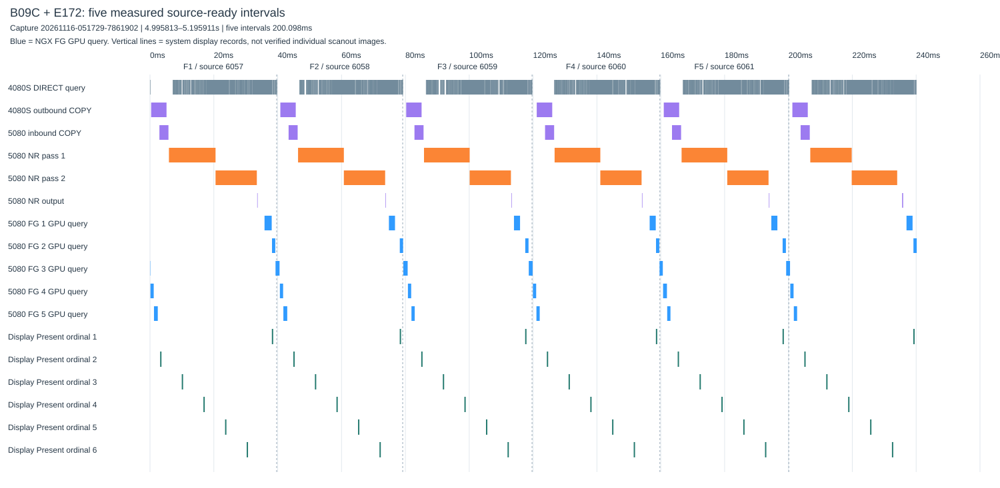

# Lifecycle pacing update — preview.4

2026-11-16: validated **B09C main + E172 official helper**. The user reports that smoothness is retained and input latency is noticeably lower.

The RTX 4080 SUPER renders the game and its super resolution, with source-process FG disabled. RTX 5080 runs NR and NVIDIA official DLSS frame generation, requesting up to 6x. Cross-frame concurrency and resource fences remain.

Input admission now reserves credit immediately, including work not yet submitted by the render thread. Submission confirms the same reservation. Three lifecycle credits allow the engine's approximately two-frame simulation/render-thread separation. Real NR completion retires credits. A timed-out gate can recover after real completion releases capacity; explicit route shutdown stays disabled.

Simply moving the capacity wait after native Reflex Sleep was rejected after B7D3 stuttered. AE5C appeared smooth, but the admission gate had permanently disabled itself before capture, leaving older queued images. B09C retains the original wait-before-Sleep order and fixes credit accounting and recovery.

| Metric | B7D3 | AE5C, gate disabled | B09C |
| --- | ---: | ---: | ---: |
| Source frames/s | 22.34 | 25.23 | 25.61 |
| SDK presentation count/s | 102.60 | 151.36 | 153.65 |
| Positive display interval P95 | 30.71ms | 9.52ms | 9.68ms |
| Display gaps over20ms | 85 | 0 | 3 |
| Simulation→first display in associated batch, mean age | 108.12ms | 136.80ms | 111.15ms |

The roughly25.65ms age reduction versus AE5C mainly occurs before source capture: simulation→capture51.19→24.18ms; capture→helper47.36→46.06ms. This is frame-age evidence, not hardware input-to-photon latency. Camera actions and scene load differ between runs, so this is not a controlled A/B performance claim.

[Offline interactive timeline](lifecycle-five-frame-timeline.html), [selected five-frame data](evidence/preview4/b09c-five-frames.json), and [three-version comparison](evidence/preview4/comparison.json). The release evidence ZIP includes all three self-contained HTML viewers.

The selection is five consecutive source-ready intervals containing capture time5.000s. Columns are source-time intervals, not display batches. Blue lanes bracket real NGX FrameGeneration EvaluateFeature GPU command recording with timestamps, indexed1–5. Six separate native Present lanes retain co-timed system display records. Generation ordinal is not verified as the same ordinal PresentId or pixel image.

The formal8.005s window contains205 input epochs, six native Presents each,1025 fully completed/calibrated/source-associated FG evaluations, and1229 retained system display records. Five pre-window evaluations lack a source-wait boundary and remain unassociated. GPU brackets include preemption/barriers and exclude independently dispatched queue work; the measured five-call sum14.03ms is not a pure shader-cost claim.

One pre-capture1s timeout recovered. Available formal-window gate snapshots are ready with advancing completion; no formal-window timeout was logged. Loading/menu cases still need improvement. Main trace lost1 record and21 fine jobs truncated; kernel ETL lost0 events/buffers. Instrumentation overhead is included.

This release deliberately retains the measurement build, unlike preview.3. Detailed FG capture requires an explicit trigger and is bounded to10s/4096 evaluations; other enabled diagnostics still have overhead. Only the tested4080S+5080/game build is supported. NR preset creation hints are retained; actual model-weight switching is unverified.

The ZIP distributes the exact accepted B09C/E172 files with hash checks, backup/rollback installer and example settings. NVIDIA runtimes/models, ReShade and game binaries are supplied separately. See [installation](INSTALL.zh-CN.md), [build validation](BUILD.md), and [provenance](PROVENANCE.md).
