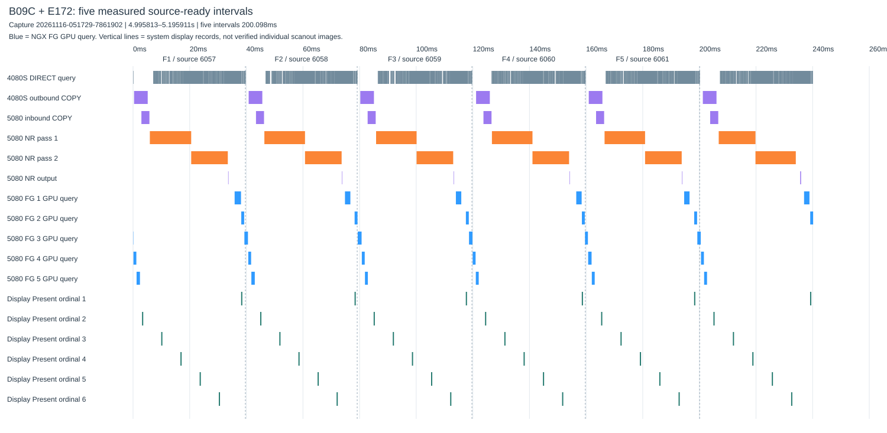

# 双 NR 节拍与低延迟更新：preview.4

2026-11-16，主模块 **B09C**＋官方 helper **E172**。用户实机反馈：**保持流畅，延迟明显降低**。

4080 SUPER负责游戏渲染和游戏DLSS超分，源端FG保持关闭；RTX 5080负责NR及其后的NVIDIA官方DLSS多帧生成，最大请求六倍。本版沿用原来的双卡分工和跨帧并行。

下载：[B09C＋E172安装包](https://github.com/wc2395082443-del/MGPU-for-NTE/releases/tag/nte-lifecycle-preview.4)。这是保留测量功能的验收版本，和preview.3的去测量版本分别保存。

## 为什么需要这次修改

双NR慢于游戏渲染时，纸面帧率不能反映画面是否按时更新。此前测到源模拟约39/79ms或16.66/70–80ms交替，官方FG的呈现间隔随源模拟节拍变化，出现长空档和同刻集中显示。

前置容量检查以前只计算已提交帧，已开始输入/模拟但渲染线程尚未提交的帧暂时不占额度。多个输入可能在旧计数下获准，随后提交阶段集中等待。

试过单独把检查移到原生Reflex Sleep之后，B7D3实机更卡；这个顺序没有进入最终版。AE5C加入预留后又暴露两个生命周期问题：输入预算只给两帧，无法始终满足游戏约两帧的模拟/渲染线程间距；等待超时还会永久关闭保护。

AE5C的正式采样发生在保护关闭之后：显示很均匀，但对应画面更旧，用户反馈输入拖延。本次报告保留这段失败记录。

## B09C的具体改动

| 环节 | 当前处理 |
| --- | --- |
| 输入准入 | 在原生Reflex Sleep之前检查容量，获准即预留一份额度。 |
| 在途计数 | 同时计算尚未提交的预留帧，以及已提交、尚未完成NR的帧。 |
| 三帧预算 | 采用既有capacity=3作为整个生命周期的预算，允许引擎推进约两帧的线程间距。资源槽和生成缓存未扩大。 |
| 提交确认 | 同一源帧从预留转为已提交，避免重复计数。 |
| 完成释放 | 真实NR完成才释放对应额度，提交后的三帧保护继续执行。等待目标仍是已有任务。 |
| 超时恢复 | 超时暂停门控；真实NR完成释放额度后可以恢复。显式关闭路由不被晚到完成重新开启。 |
| 运行可观测性 | 日志给出submitted、reserved、recovering，验证保护是否实际工作。 |

有容量时继续渲染下一帧，与之前的NR并行；满时等待旧任务释放容量。当前渲染帧无需逐张等自己的NR完成。

## 实测结果和对照条件

三次都是4080S＋5080、双NR、官方最大六倍的短窗口。转镜头动作及场景负载没有完全控制，因此下面是实机记录对照，不能视为严格同负载A/B。

| 指标 | B7D3：顺序实验 | AE5C：保护已失效 | B09C：本次验收 |
| --- | ---: | ---: | ---: |
| 正式窗口 | 8.012s | 8.007s | 8.005s |
| 源帧/s | 22.34 | 25.23 | **25.61** |
| 官方SDK呈现计数/s | 102.60 | 151.36 | **153.65** |
| 正显示间隔P95 | 30.71ms | 9.52ms | **9.68ms** |
| 最大显示间隔 | 67.07ms | 19.49ms | **23.21ms** |
| 大于20ms显示间隔 | 85 | 0 | **3** |
| 源模拟间隔最大 | 90.30ms | 42.88ms | **42.79ms** |
| 模拟→helper接收平均年龄 | 59.54ms | 98.55ms | **70.24ms** |
| 模拟→同批首次显示平均年龄 | 108.12ms | 136.80ms | **111.15ms** |

相对B7D3，当前版的显示节拍明显更均匀。相对同样流畅的AE5C，平均画面年龄减少约25.65ms，用户确认输入延迟明显降低。显示P95相近，当前也仍有3处20ms以上间隔。

年龄分解显示，模拟→源帧采集约 **51.19→24.18ms**，源采集→helper约 **47.36→46.06ms**。本轮减少的等待主要发生在渲染前段，而非NR/FG算法计算加速。

源模拟到呈现批次的年龄不是硬件输入到光子延迟，批次首张显示也没有逐像素证明为原生图像。153.65/s是官方计数；实际显示节拍单独报告。

## 五帧流水线：怎样读

[下载完整离线交互图](lifecycle-five-frame-timeline.html) · [三版测量数据](evidence/preview4/comparison.json) · [B09C五帧明细](evidence/preview4/b09c-five-frames.json)

Release另附`MGPU-for-NTE-five-frame-evidence-preview.4.zip`，包含B7D3、AE5C、B09C三个完整自包含HTML。下载后解压并用Chrome/Edge打开；支持5/10/20帧、全程、单批放大、悬停和JSON导出。

- 五帧固定选取包含采样第5.000秒的连续五个源帧就绪区间，选择规则可重复，没有挑最快片段。
- 横向F1–F5分栏是源就绪间隔。NR、FG和显示可跨栏，按源编号核对同一批。
- 4080S DIRECT及COPY、5080接收COPY、NR1、NR2和输出快照分别显示。
- 五条蓝色FG泳道来自真实NGX FrameGeneration EvaluateFeature命令录入前后的GPU时间戳，分别是公开生成序号1–5。
- 六条显示泳道是同一输入fence批次的原生DXGI Present序号。生成序号与Present序号属于不同编号域；同编号不保证同一图像。
- 竖线表示系统显示时间戳。相同时间戳的记录分别画出，同刻记录不能证明每张都有独立屏幕停留时间。

### B09C正式窗口的覆盖

205个输入批次全部匹配六次原生Present；1025次FG调用全部有完成、GPU校准、源帧关联及有效序号。1229条系统显示记录按PresentId逐个保留。

采样开头另有5次FG调用位于正式窗口之前，缺少输入等待边界，保留为未关联。完整采样首次严格校验失败的事实和正式窗口独立校验通过分别记录，不把窗口外缺项补成有效数据。

五次FG查询区间之和均值14.03ms。它包含抢占和同一命令列表中的屏障，额外独立队列工作也不自动包含；不能当作整个FG系统的芯片纯计算成本。

GPU上下文RUNNING、命令包提交→完成、输入生命周期和真实FG时间查询采用不同轨道，不能相加成每帧耗时。

## 门控、采集和兼容性边界

本次采样前有一次1秒等待超时，随后真实NR完成恢复了门控。正式窗口可用状态快照均ready=1，完成编号推进，窗口内没有超时；这是周期状态证据，不是逐帧证明。
所以“全部预留尚未提交”的阶段仍需继续改进，不能保证菜单、载入和所有切场景都无停顿。

主流丢失1条、细分截断21个任务；内核ETL事件及缓冲丢失0。正式窗口有鼠标移动和相机变化，前台515/515。测量本身有开销，未剔除；B09C仍为诊断构建。

本版主程序恢复GPU计时及CPU/队列详细采集入口，helper保留追踪及NGX计时入口。FG计时默认不启动，需显式事件触发，一次最多10秒/4096次评估；详细流水线也需独立触发。正常状态、日志及部分GPU计时仍有开销。本版不是preview.3的去测量构建。

仅验证4080S＋5080和本次异环EXE。其他50系副卡、赛博朋克实验未合入。NRPreset面板保留创建期hint，运行库可能回退，权重实际切换未确认。

## 文件身份

| 文件 | SHA256 |
| --- | --- |
| 主DLL | `B09CA7B12A3B23069FFB35DDB9F08D8684239DBAFDFEBB486E78EEAFA7922BF0` |
| 官方helper | `E172D87654241079991C3D8766BDCE66B7B763235720703EAA1F3B1DD3B0A767` |
| 支持的HTGame.exe | `64ED3CAE0B5FC61F3B56CDD933B4807CB23F0EC7913590DB60D1A8642DE2DFEC` |

发布包使用已验收的精确文件；重编译结果另作构建验证。包内含安装/备份/回退、配置模板、shader及哈希，不含NVIDIA运行库/模型、ReShade或游戏文件。既有配置默认保留。

[安装](INSTALL.zh-CN.md) · [构建和测试范围](BUILD.md) · [来源](PROVENANCE.md)
